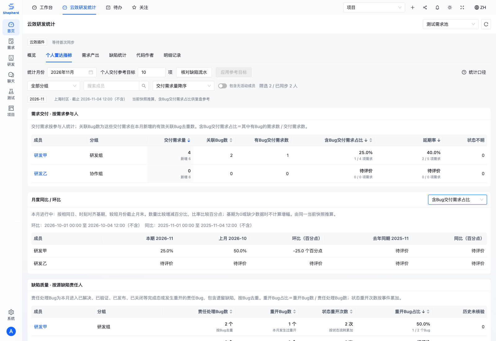
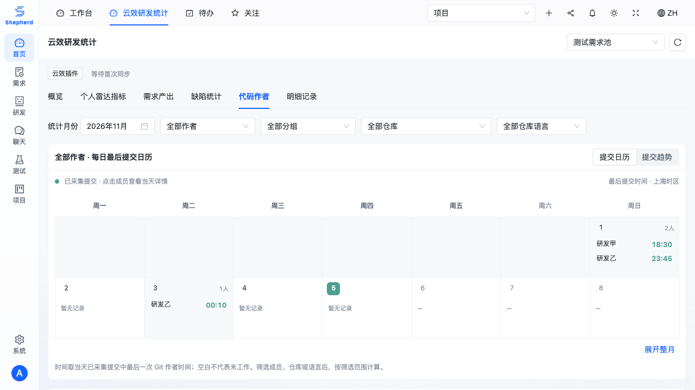

# Shepherd 云效同步插件

插件依附于 Shepherd 主应用，复用其服务入口、会话与权限，数据和迁移使用独立数据库。

- `plugin.json`：Shepherd 插件目录使用的元信息。
- `backend/`：可选 Rust crate `shepherd-yunxiao`，由 server 的 `yunxiao` feature 编译。
- `scripts/`：只读采集器和单元测试，通过 Shepherd 同步 API 提交快照。
- `deploy/`：用户级定时采集单元。
- 前端扩展位于 `web/src/plugins/yunxiao/`，由 Shepherd 插件状态控制入口。

在 Shepherd 服务中设置 `SHEPHERD_PLUGINS=yunxiao` ，配置独立的 `SHEPHERD_YUNXIAO_DATABASE_URL` 并重启即可启用。
完整配置、构建和验证步骤见 [运维文档](../../docs/YUNXIAO.zh-CN.md)。

## 岗位产出

工作台与云效统计页通过插件接口读取当前项目关联的数据源，不向 Shepherd 核心表写入统计数据。

- 产品：新增需求按创建时间/创建人；交付按当前已发布状态、源状态变更时间和当前负责人，不推算历史经手人。
- 测试：新增用例与缺陷按源创建时间/创建人。没有创建人的记录归为“待归属”，不以负责人代替。
- 研发：排除合并提交，区分组织实际提交与当前源需求关联提交；增删行只计关联提交，并显示未知行数提交量。
- 7/30/90/365 天区间使用上海自然日（含今天），环比为前一个等长自然日区间；缺少事件时间的记录不进入趋势，页面显示缺失数量与同步/代码采集范围。
- 岗位是指标视角，不代表自动认定的成员岗位或绩效分数。权限沿用插件读取校验，包含测试用例读取权限。

采集器新增 `creator` 字段；升级后下次成功同步会补齐源提供的创建人。首次同步时间不作为产出日期。

工作台通过通用插件扩展位按需加载此卡片，不直接引用云效页面或 API；插件未启用、项目未关联数据源时不显示卡片。插件页面复用 Shepherd 公共布局和主题变量，统计口径集中到单一的按需说明入口。

趋势格悬浮或键盘聚焦后才请求当日明细，同一数据版本按日期/指标缓存；首屏最多 5 条，可跳转至保留源、日期、指标的分页列表。需求按创建/交付事件时间匹配，用例按创建时间匹配，关联提交附带同一插件源内的需求编号与名称。接口校验指标、日期及对应资源读取权限，返回数据不含原始采集载荷。
关联需求引用兼容云效编号（如 `DCZ-1234`）及外部 ID；只在同一插件源中解析，优先精确 ID，最多返回一条匹配需求。

## 单需求角色与关联

「需求产出」按同一插件源的需求 ID 或编号查询：产品显示需求创建人与当前负责人，测试显示明确关联的缺陷、发现人与当前处理人，研发显示真实提交作者、增删行和全部关联仓库。仓库按 ID 汇总；未知行数保留为未知。默认范围是全部已采集记录，可切换最近 7/30/90/365 天。缺陷与提交分别分页，统计总量不受分页影响。

Shepherd 需求详情通过通用可选扩展位按需加载该视图，仅使用标题中明确的源需求编号进行映射；不按相似标题猜测，不新增核心业务字段。关闭插件时不加载对应页面或发起插件请求。缺陷明细与需求名称分别校验 BUG:READ 与 REQUIREMENT:READ 权限。

采集器只读获取缺陷父需求及 Projex ASSOCIATED 工作项关系，过滤为当前源内的已知需求；提交沿用云效提供的显式需求引用，支持多个代码仓库。「缺陷统计」展示真实状态分布、发现人及已关联/未关联数量，不猜测自定义状态是否属于已解决。

关联读取采用私有本地缓存（0600），所有读取成功后才发布快照；失败保留上次数据。可通过 `SHEPHERD_BUG_RELATION_CACHE` 指定缓存文件，`SHEPHERD_BUG_RELATION_CACHE_SECONDS` 设置有效期（默认 3600 秒），`SHEPHERD_BUG_RELATION_QPS` 调整读取速率（默认 4，最高 10）。首次全量读取耗时随缺陷数量增长。

需求版本列表与详情使用现有富文本解析和净化组件展示云效 htmlValue，兼容普通 Markdown；不修改原始版本数据。

## 个人月度雷达指标

云效统计页新增「个人雷达指标」，仅在选择该页签时请求插件 API。支持上海自然月、组织分组、成员搜索、交付量参考目标和个人需求明细；刷新或切换来源时清除旧结果。默认查看上海时区的当前月份；未指定月份的页面跨月保持打开时会自动更新，手动选择历史月份则保留选择。

- 需求量：本月已发布需求，按当前负责人及明确登记的开发/测试/协作角色计参与次数。旁观者不自动作为交付人，已同步参与人无活动时仍显示；不假定来源包含完整组织成员。分组读取已同步映射，冲突与缺失列待归属。
- 关联 Bug 率：本月交付且本月存在有效关联 Bug 的需求数 / 本月交付需求数。同一源内按父需求、明确关联的外部 ID 或编号识别，对需求和 Bug 分别去重，排除取消、重复、误报等终态。这是参与需求的缺陷情况，不使用 Bug 处理人推断责任开发者。
- 延期率：当前未交付且已超期数 / (本月应交付 - 状态不明)。已发布、已交付及其他完成终态不计延期；超期后完成、统计月之后完成或缺少完成时间的已交付项也排除，历史月份同样使用当前交付状态。包含全部优先级，以采集的最早截止日当天结束为界；取消及其他完成终态不进应交付分母，只有已发布视为交付。进行中的月份仅统计已经到期的排期。无排期不进入分母。`requirements[].currentDelivered` 标记当前交付状态，区别于 `delivered` 的本月发布口径；`deliveredDueRequirements` 为应交付样本中当前已交付数。`onTime` / `deliveredLate` 仅保留时间分类信息，不作为延期分子。
- 雷达为统一 0–100 的三个展示指数：交付量 `min(交付量/参考目标,1)×100`、关联质量 `100-Bug率`、交付时效 `100-延期率`。参考目标默认10项，可调，不代表正式OKR目标。原始数量与比率同时保留；无分母或缺少Bug关联数据时待评价，不补零或满分，不画完整填充区域，不计算综合评分。
- 历史月份按当前快照推算，不能还原负责人、排期修改或需求重开；截止后变更的非发布状态及缺少状态时间的到期需求单列不明。页面显示采集截点、无排期/缺时间数量和样本量，可逐人查看构成需求并跳转需求产出页。

API：`GET /api/devops/sources/{id}/member-metrics?month=2026-10&requirementTarget=10`，要求 `PROJECT:READ`、`REQUIREMENT:READ`、`BUG:READ`。来源、时间和投影事实在插件数据库的单条查询快照中读取，不访问核心业务表，不返回原始采集载荷；无需新迁移或新采集任务。关闭插件时入口及请求均不存在。可视化参考[飞书表格雷达图](https://www.feishu.cn/hc/zh-CN/articles/352365254274-表格雷达图)，跟随应用明暗主题并支持窄屏。

验证：`cargo test -p shepherd-yunxiao --all-features --locked`；使用隔离的 `SHEPHERD_YUNXIAO_TEST_DATABASE_URL` 运行 `pg_sync` 的 ignored 集成测试；前端执行 `npm run build` 和 `npx playwright test member-metrics.spec.ts`。

### 人员识别与展示边界

自定义角色字段只有 `fieldFormat=user/multiUser` 且带有效用户 `identifier` 才计作成员；字段名包含“人”或 `displayValue` 看起来像姓名都不是依据。“需求提出人”等自由文本中的客户名称、说明不会生成成员。已有快照已保留字段类型，无需重新同步即可修正。

个人指标默认按交付量排序，默认查看当月有需求/交付/到期数据的成员，可开启「包含无活动成员」查看其余已同步参与人。指标表与雷达图共用筛选、排序及分页，每页默认6人。比率在同一格展示分子/分母；表格固定列宽，长成员名、分组和需求标题使用省略与全文提示，明细抽屉同样约束宽度。雷达卡片按桌面3列、中屏2列、窄屏1列排布。

### 月度同比与环比

「月度同比 / 环比」表可切换交付需求量、关联 Bug 数、含 Bug 交付需求占比、延期率、状态重开次数及重开 Bug 占比，跟随上方分组、搜索、排序和分页。接口 `metrics.comparisons` 使用与本期相同的原子源快照，提供紧凑的上月及去年同期成员指标和起止时间，不再单独读取不同版本的源数据。

当前月按上海日期的相同日和时刻比较；基期较短时截止基期月末，例如 3 月 31 日对比 2 月全月。历史完整月份比较整月。数量显示相对基期的增减百分比，比率显示百分点差；基期为 0、成员缺少基期记录、比率无分母或重开历史未核验时不伪造增幅。历史数据仍由当前快照推算，无法还原缺失的状态、排期及归属变更。

### 月份筛选与小组雷达对比

月份使用应用内中文月份选择器，显示 `YYYY年MM月`，按上海日历月以 `YYYY-MM` 请求接口；禁止选择未来月份，无效链接会修正为当前月份并提示。月份、小组、参考目标、图表视图和显式对比成员保存在链接中，支持刷新与前进/后退。快速切月时旧请求不能覆盖新窗口，加载期间保留筛选控件；小组在该月无成员时保持空结果，不自动回退为全部。

选择小组后默认显示「组内对比」，最多选择6位本组成员，使用相同0–100刻度，以颜色、线型和原始指标图例对应个人。缺失维度仅显示已知点；这不是小组总分，不将多人参与需求数相加当作去重需求量。可切换「个人雷达」查看原有单人卡片。组内对比的成员选择独立于明细表分页；个人卡片仍与明细表同步翻页。

可分享链接示例：`/devops?view=radar&month=2026-10&group=AI算法组&chart=group`；`requirementTarget` 配置参考目标，`compare` 为最多6个成员名的JSON数组。切换数据源时清除旧小组和对比成员，保留月份与参考目标。

成员指标的交付需求量与关联 Bug 数支持表头、下拉框统一升降序排序。排序覆盖当前筛选的全部成员，在分页前应用，并同步个人雷达、组内对比和成员选项；同值按姓名稳定排列。排序字段与方向写入 URL，刷新和浏览器前进后退可恢复。

### 缺陷状态重开与核验（Reopen）

需求关联 Bug 率仍是需求参与口径，状态重开改为独立的 Bug 口径，不能互相套用范围或分母：

- 范围：读取所选上海自然月的云效状态动态，包含历史月份创建的遗留 Bug，不要求 Bug 本月新增、关联需求或需求本月已发布。核验表包括本月新增/发生状态流转的 Bug；缺少历史的潜在记录保留待核验。
- 归属：仅使用带用户标识的“缺陷责任人”字段；不以当前处理人、需求参与人或开发者推断责任人。缺失时待归属。表格分别显示源责任人、源开发者、源测试人员与发现人，当前字段不能自动代表历史时点责任或本次修复责任。
- 次数：本月从已解决/已验证/已发布/已关闭等完成态退回活动态，或明确进入重开态的事件数。按事件ID去重，同一 Bug 多次重开分别累加。
- 比例：本月重开过的 Bug 去重数 / 本月进入完成态或发生重开的 Bug 去重数。新建但未处理完成的 Bug 不进入该分母。零分母或相关历史未核验时待评价，未知值在升降序中均排最后。
- 证据：“缺陷重开核验”可按编号、责任人等搜索，逐条查看状态、时间、事件及创建日期（上海时区）。这是状态重开，不能把聊天返修、修改字段数量或人工复测次数自动视为云效重开事件；人工复核表与源字段不一致时需保留各自来源。

个人缺陷质量表与责任处理明细使用上述责任口径；`metrics.bugQuality` 提供按源缺陷去重的总量和核验行，避免多人参与需求导致倍增。需求交付雷达独立使用需求参与口径，图例与卡片不再混入责任重开指标。

只读采集使用 [ListWorkitemActivities](https://help.aliyun.com/zh/yunxiao/developer-reference/listworkitemactivities)。`reopenHistory.schemaVersion=2` 保留完整状态流水、完成态及重开事件投影，缺少创建动态或未知状态时完整性不通过。完成月份要求采集覆盖月末；进行中月份以本月快照为准。旧版只含重开事件的缓存不能用于新的处理 Bug 分母，应重新完整采集，默认私有缓存 `~/.cache/shepherd-yunxiao/bug-history-v2.json`（0600）。可配置 `SHEPHERD_BUG_HISTORY_CACHE`、`SHEPHERD_BUG_HISTORY_CACHE_SECONDS`（默认24小时）、`SHEPHERD_BUG_HISTORY_QPS`（默认4，最高10）；源修改时间改变或投影版本改变时重新读取，任一上游读取失败保留旧快照。

部署时同时更新定时采集脚本并发布完整历史快照；无需数据库迁移，数据仍仅在插件数据库内。

### 需求参与与缺陷责任分表

同一成员的两种业务集合分别展示，过滤、全量排序与分页仍同步：

- **需求交付 · 按需求参与人**：交付需求量、关联 Bug 数、有 Bug 交付需求数、含 Bug 交付需求占比、延期率。含 Bug 交付需求占比是原 API `bugRate` 的准确名称，分子和分母均为需求，不是 Bug 数 / 需求数。
- **缺陷质量 · 按源缺陷责任人**：责任处理 Bug 数、重开 Bug 数、状态重开次数、重开 Bug 占比、历史未核验数。比例格显示重开 Bug / 责任处理 Bug；次数格仅显示事件次数，不再放入另一单位的分子/分母。责任处理明细仅列本月进入完成态/重开的集合及历史待核验记录。
- 例如需求侧有25个关联 Bug，责任侧有58个处理 Bug，其中11个重开、共14次，则责任重开占比为11/58=19.0%。25与58是不同集合，不能互换；14是事件数、11是Bug数。

排序下拉按需求参与、缺陷责任、通用分组；新增责任处理 Bug 数与重开 Bug 数排序。历史未核验时显示已知数量下限、比例待评价，未知值在两个排序方向均置后。后端统计定义和 API 字段不变。

## 代码作者月度趋势

「代码作者」保留 URL 的统计月份，支持作者、分组、仓库、仓库语言筛选。作者行可展开到仓库，显示源码语言组成、本期提交次数、增删行及本期最近提交时间。仓库语言从本机只读 Git 缓存的默认分支树按源码扩展名与字节数识别，跳过依赖、构建目录和压缩文件；它代表仓库组成，不推断某次提交使用的语言。没有缓存或无法识别时显示“未识别”。缓存根目录可用 `SHEPHERD_CODE_REPO_CACHE` 配置，默认 `~/shepherd-code-rag`。

月度接口 `GET /api/devops/sources/{id}/code-authors?month=YYYY-MM` 使用上海自然月左闭右开范围，在同一源内按仓库 ID + SHA 去重并排除合并提交。X 轴为每个有提交日期最后一次 Git 作者时间，Y 轴可选提交次数或新增+删除行数。缺少行数时图中留空、表格显示已知下限，不伪造零。悬浮、键盘聚焦/回车可查看当天仓库与关联需求，需求名称仅在有需求读取权限时返回。最近采集范围并不等于历史完整覆盖范围。

部署需一并更新 `yunxiao_sync.py` 与 `yunxiao_repository_languages.py`；历史提交可只补充语言元数据，不能把仅含提交的批次作为完整快照发布。

### 每日最后提交日历

代码作者默认显示提交日历；每个成员每天独立展示最后一次 Git 作者提交时间（上海时区），支持成员、分组、仓库和语言筛选。点击成员可查看当天提交、仓库及有权限读取的关联需求。空白日期表示尚无已采集记录，不用于推断工作时长。当前月默认折叠后续周，可展开整月；历史月份完整展示。`activity=trend` 可切回提交趋势图。

